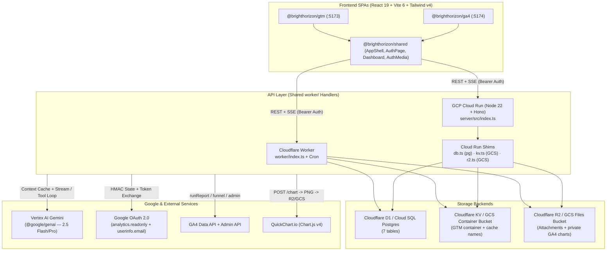

# BrightHorizon GTM & GA4 Auditor — AI-Powered Container & Analytics Suite

An intelligent dual-app monorepo for auditing **Google Tag Manager containers** (`@brighthorizon/gtm`) and querying **Google Analytics 4 properties** (`@brighthorizon/ga4`), powered by **Google Gemini** (Vertex AI) and deployable on either **Cloudflare Workers** or **Google Cloud Run**.

[](https://react.dev/)
[](https://vite.dev/)
[](https://www.typescriptlang.org/)
[](https://tailwindcss.com/)
[](https://workers.cloudflare.com/)
[](https://cloud.google.com/run)
[](https://cloud.google.com/vertex-ai)

---

## What is BrightHorizon Auditor?

GTM containers often grow to tens of thousands of lines of JSON across hundreds of tags, triggers, and variables, while GA4 properties accumulate complex event schemas, custom dimensions, and conversion funnels. BrightHorizon solves both in a shared-core pnpm monorepo with two purpose-built frontend SPAs backed by one unified API layer.

### Two Standalone Apps, One Shared Engine

| App | Package | How It Works | Powered By |
|-----|---------|-------------|------------|
| **GTM Auditor (`:5173`)** | `@brighthorizon/gtm` | Loads your minified GTM container into a Gemini Context Cache and streams deep container audits over SSE. | Vertex AI Gemini Context Cache (`3600s` TTL) + SSE |
| **GA4 Analyst (`:5174`)** | `@brighthorizon/ga4` | Connects per-user via Google OAuth 2.0; Gemini uses parallel function calling against live GA4 APIs and generates private Chart.js v4 charts. | Vertex AI Function Calling + GA4 Data/Admin APIs + QuickChart v4 |

### Example Questions You Can Ask

**GTM Mode:**
- *"Are there any tags with missing consent settings?"*
- *"Show me all triggers that fire on pageview"*
- *"Summarize the overall health and test artifacts in this container"*
- *"Which variables reference cookies or custom JavaScript?"*

**GA4 Mode:**
- *"What are my top 10 events in the last 30 days?"*
- *"Show me daily active users for the past week as a line chart"*
- *"Show me the checkout funnel from `page_view` → `begin_checkout` → `purchase`"*
- *"List all custom dimensions and metrics configured on this property"*

---

## Features

### Core Platform & UX
- **Two Dedicated Apps, Zero UI Duplication**: `@brighthorizon/gtm` and `@brighthorizon/ga4` are thin wrappers around `AppShell` and `AuthPage` in `@brighthorizon/shared`, with mode-specific themes (`#1a3a5c` navy for GTM, `#e8710a` orange for GA4) and app-scoped accounts (`app IN ('gtm', 'ga4')`).
- **Model Selector**: Dynamically discovers Vertex AI Gemini models via `GET /api/models` (cached 30 min in memory) with curated defaults (`gemini-2.5-flash`, `gemini-2.5-pro`, `gemini-2.5-flash-lite`, `gemini-2.0-flash`).
- **Auto-Resizing Composer & Stop Generation**: Multi-line `<textarea>` (`Enter` sends, `Shift+Enter` inserts newline) paired with an `AbortController` **Stop** button to cancel in-flight requests cleanly.
- **Rich Markdown & Severity Cards**: `@tailwindcss/typography` + `react-markdown` + `remark-gfm` + `remark-breaks` render tables with one-click copy-to-clipboard, code blocks, and severity cards (`Critical`, `High`, `Medium`, `Low`).
- **Smart Session Management**: Persistent per-user, per-mode sessions grouped by `Today`, `Yesterday`, `This Week`, and `Earlier`, auto-titled after the first reply, plus a hoverable `ChatOutline` navigator.

### GTM Mode
- **Lossless Operator-Preserving Minification (`gtm-minifier.ts`)**: Reduces large GTM container exports while resolving `{{_u:ID}}` variable references, firing/blocking trigger names, custom template IDs, condition operators (`contains`, `equals`, `matches regex`, `matches CSS selector`, `starts with`, etc.), `negate` flags (`does not ...`), and `ignore_case`.
- **Model + Hash Scoped Context Caching**: Keys Gemini context caches in KV/GCS by `${KV_CACHE_KEY}:${model}:${sha256(container)}` (1-hour TTL) with automatic fallback to inline system instructions.
- **True SSE Streaming**: Token-by-token streaming with disconnect-safe writers and post-stream persistence.

### GA4 Mode
- **Per-User Google OAuth 2.0**: Requests `analytics.readonly` + `userinfo.email` scopes with HMAC-SHA256 signed `state` (10-minute TTL), AES-GCM encrypted tokens at rest, and automatic refresh-token rotation/expiry detection (`GA4_TOKEN_EXPIRED`).
- **Parallel Tool Calling (8 Tools)**: Executes multiple simultaneous Gemini tool calls in parallel (`Promise.all`) up to 20 turns, filtering internal Gemini `thought` reasoning traces before returning final answers.
- **Private Chart.js v4 Persistence**: Renders Chart.js v4 visualizations via QuickChart POST API, stores PNGs privately inside `CHAT_FILES` (R2 or GCS) at `/api/files/:id`, and persists chart URLs in `messages.charts` so charts survive page reloads.

### Multimodal File Attachments
- **Upload via Picker, Drag-and-Drop, or Paste**: Up to 10 files / 25MB per file stored in R2 (Workers) or GCS (Cloud Run).
- **Rich Extraction & Authenticated Viewing**: Supports images (PNG/JPEG/GIF/WebP), PDFs, CSV/JSON/TXT/MD/HTML/SVG, and zero-dependency OOXML extraction (`DecompressionStream`) for `.docx` and `.xlsx`/`.xlsm`. Protected files and charts render in-app via authenticated Blob fetches (`AuthImage` / `openAuthenticatedFile`).

### Security
- **Bearer-Only Authentication**: Rejects `?token=` URL parameters; accepts `Authorization: Bearer <token>` only.
- **PBKDF2-SHA256 + Constant-Time Compare**: 100,000-iteration salted password hashing with `timingSafeEqual` verification.
- **Atomic Invite-Only Access**: Bootstrap creates the first account; subsequent signups require a single-use, app-scoped `INV-...` key redeemed atomically in a DB transaction.
- **Hardened Endpoints**: Per-IP auth rate limiting, per-user chat rate limiting, origin-allowlisted CORS (`ALLOWED_ORIGINS`), HTML-escaped OAuth result pages with origin-scoped `postMessage`, sandboxed file serving (`Content-Security-Policy: sandbox`, `X-Content-Type-Options: nosniff`, `Cache-Control: private`, inline MIME allowlist), and scheduled expired-token cleanup.

---

## Architecture

### Dual-Runtime High-Level Flow



See [architecture_detailed.html](file:///c:/Users/FlameBreather/OneDrive/Desktop/Projects/A2ZDM/Final%20GTM%20GA4%20Project/GTM-GA4-Auditor/architecture_detailed.html) for interactive diagrams and step-by-step walkthroughs, or [architecture_graph.html](file:///c:/Users/FlameBreather/OneDrive/Desktop/Projects/A2ZDM/Final%20GTM%20GA4%20Project/GTM-GA4-Auditor/architecture_graph.html) for standalone Mermaid diagrams.

---

## Monorepo Structure

```text
GTM-GA4-Auditor/
├── frontend/
│   ├── apps/
│   │   ├── gtm/                        # @brighthorizon/gtm SPA (port 5173)
│   │   │   ├── src/
│   │   │   │   ├── App.tsx             # Thin wrapper rendering <AppShell mode="gtm" />
│   │   │   │   └── main.tsx
│   │   │   ├── index.html
│   │   │   ├── package.json
│   │   │   ├── tsconfig.json
│   │   │   └── vite.config.ts
│   │   └── ga4/                        # @brighthorizon/ga4 SPA (port 5174)
│   │       ├── src/
│   │       │   ├── App.tsx             # Thin wrapper rendering <AppShell mode="ga4" />
│   │       │   └── main.tsx
│   │       ├── index.html
│   │       ├── package.json
│   │       ├── tsconfig.json
│   │       └── vite.config.ts
│   └── packages/
│       └── shared/                     # @brighthorizon/shared workspace package
│           ├── src/
│           │   ├── components/
│           │   │   ├── AppShell.tsx    # Shared app layout, session state & routing
│           │   │   ├── AuthMedia.tsx   # AuthImage & openAuthenticatedFile (Blob fetch)
│           │   │   ├── AuthPage.tsx    # Unified Login / Invite Signup / Bootstrap UI
│           │   │   ├── ChatOutline.tsx # Hover turn navigator
│           │   │   ├── Dashboard.tsx   # Chat stream, markdown, drag-drop, textarea + Stop
│           │   │   ├── Ga4Settings.tsx # OAuth connection & GA4 property picker
│           │   │   ├── InviteKeyPanel.tsx
│           │   │   ├── ModelSelector.tsx
│           │   │   ├── Sidebar.tsx
│           │   │   └── Toast.tsx
│           │   ├── context/AuthContext.tsx
│           │   ├── services/{authApi,chatApi}.ts
│           │   ├── utils/{clean-json,gtm-minifier}.ts
│           │   ├── index.css           # Tailwind v4 + @tailwindcss/typography + custom theme
│           │   ├── index.ts
│           │   └── vite-env.d.ts
│           ├── package.json
│           └── tsconfig.json
├── worker/                             # Core API handlers (Web-standard Request/Response)
│   ├── index.ts                        # Cloudflare Worker fetch() + scheduled() cron
│   ├── types.ts                        # Env bindings, AuthUser, constants
│   ├── middleware/auth.ts              # Bearer authentication & expired token cleanup
│   ├── routes/
│   │   ├── auth.ts                     # Bootstrap, invite signup, login, logout, invite keys
│   │   ├── chat.ts                     # GTM SSE + GA4 tool loop + message persistence
│   │   ├── files.ts                    # Upload, list, sandboxed download, delete
│   │   ├── ga4-oauth.ts                # Signed OAuth authorize/callback/status/properties
│   │   ├── models.ts                   # Dynamic Vertex AI Gemini model list (30m cache)
│   │   └── sessions.ts                 # Session CRUD, property binding, attachment cleanup
│   ├── services/
│   │   ├── gemini-chat.ts              # Context caching, SSE streaming, parallel GA4 loop
│   │   └── ga4/
│   │       ├── api.ts                  # GA4 Data & Admin API tools + numeric validation
│   │       ├── oauth.ts                # Token encryption/refresh & escaped HTML callback
│   │       └── tools/charts.ts         # QuickChart v4 + private R2/GCS chart persistence
│   └── utils/
│       ├── crypto.ts                   # PBKDF2, timingSafeEqual, AES-GCM, HMAC state
│       ├── file-helpers.ts             # Base64, text & OOXML (.docx/.xlsx) extraction
│       ├── genai-client.ts             # Vertex AI client (SA JSON or Cloud Run ADC)
│       ├── http.ts                     # Origin-aware CORS & JSON helpers
│       └── rate-limit.ts               # In-memory fixed-window rate limiter
├── server/                             # @gtm-auditor/server (Cloud Run Node 22 + Hono)
│   ├── src/
│   │   ├── index.ts                    # Hono app, CORS, /healthz, /readyz, token cleanup
│   │   ├── bootstrap.ts                # Auto-init Postgres schema, metadata project & GCS seed
│   │   ├── env.ts                      # Singleton GCP adapters & credential/bucket resolution
│   │   ├── db.ts                       # Postgres D1 shim (Cloud SQL socket, TCP, DATABASE_URL)
│   │   ├── kv.ts                       # GCS KV shim (in-memory cache + local container fallback)
│   │   └── r2.ts                       # GCS R2 shim (Readable.toWeb streaming)
│   ├── .env.example
│   ├── package.json
│   └── tsconfig.json
├── deploy/                             # Turnkey GCP Cloud Run + Cloud SQL + GCS scripts
│   ├── cloudrun-setup.ps1              # PowerShell end-to-end provisioning & deploy
│   └── cloudrun-setup.sh               # Bash / Cloud Shell provisioning & deploy
├── tests/                              # Automated unit test suite (node:test)
│   ├── crypto.test.ts
│   ├── gtm-minifier.test.ts
│   ├── server-bootstrap.test.ts
│   └── worker-routes.test.ts
├── data/                               # Raw & minified GTM container exports
├── get-minified.ts                     # CLI GTM cleaner + minifier
├── schema.sql                          # Cloudflare D1 (SQLite) schema (7 tables)
├── schema-postgres.sql                 # Cloud SQL (Postgres) schema (7 tables)
├── wrangler.toml.example               # Cloudflare Worker configuration template
├── Dockerfile                          # Multi-stage self-bootstrapping Cloud Run container
├── docker-entrypoint.sh                # Materializes SA JSON / ADC & supports --init-only
├── docker-compose.yml                  # Local Postgres 16 + self-initializing server stack
├── .dockerignore
├── metadata.json
├── pnpm-workspace.yaml
└── package.json
```

---

## API Reference

All API endpoints are prefixed with `/api` (`POST`, `GET`, `PUT`, `PATCH`, `DELETE`). Protected routes require `Authorization: Bearer <token>`.

### Authentication (`/api/auth/*`)

| Method | Endpoint | Auth | Description |
|--------|----------|------|-------------|
| `POST` | `/api/auth/bootstrap` | No | Create the initial user when `users` is empty (rate limited) |
| `POST` | `/api/auth/signup` | No | Register with an app-scoped single-use `INV-...` key (atomic claim) |
| `POST` | `/api/auth/login` | No | Authenticate with email + password scoped by app (`gtm` \| `ga4`) |
| `POST` | `/api/auth/logout` | Optional | Delete current auth token & purge expired tokens |
| `GET` | `/api/auth/me` | Yes | Return authenticated user profile |
| `POST` | `/api/auth/invite` | Yes | Generate a new single-use invite key scoped to the app |
| `GET` | `/api/auth/invite-keys` | Yes | List invite keys created by the current user |

### Sessions & Messages (`/api/sessions/*`)

| Method | Endpoint | Auth | Description |
|--------|----------|------|-------------|
| `GET` | `/api/sessions?mode=gtm\|ga4` | Yes | List sessions for the current user and mode |
| `POST` | `/api/sessions` | Yes | Create a new session (`{ id, title?, mode?, ga4_property_id? }`) |
| `PATCH` | `/api/sessions/:id` | Yes | Rename a session (`{ title }`) |
| `DELETE` | `/api/sessions/:id` | Yes | Delete a session, its messages, and all associated R2/GCS files |
| `GET` | `/api/sessions/:id/messages` | Yes | Get ordered messages enriched with `charts` and `attachments` |
| `PUT` | `/api/sessions/:id/property` | Yes | Set/clear numeric `ga4_property_id` on a session |

### Chat & Models (`/api/chat`, `/api/models`)

| Method | Endpoint | Auth | Description |
|--------|----------|------|-------------|
| `POST` | `/api/chat` | Yes | Send `{ question, sessionId?, chatMode?, model?, attachmentIds? }` (`30 req/min` per user) |
| `GET` | `/api/models` | Yes | List available Gemini models (Vertex AI discovery cached 30 min + curated defaults) |

- **GTM Mode (`chatMode: 'gtm'`)** returns `text/event-stream` SSE chunks: `data: {"text":"..."}` ending with `data: [DONE]`.
- **GA4 Mode (`chatMode: 'ga4'`)** returns JSON: `{ "answer": "...", "charts": ["/api/files/chart-..."] }`.

### Files & Attachments (`/api/files/*`)

| Method | Endpoint | Auth | Description |
|--------|----------|------|-------------|
| `POST` | `/api/files/upload` | Yes | Upload up to 10 multipart files (25MB max each) for a session |
| `GET` | `/api/files?sessionId=...` | Yes | List attachments for a session |
| `GET` | `/api/files/:id` | Yes | Download/view an attachment (`Cache-Control: private`, CSP `sandbox`, safe inline allowlist) |
| `DELETE` | `/api/files/:id` | Yes | Delete a file from R2/GCS and DB metadata |

### GA4 OAuth & Properties (`/api/ga4/*`)

| Method | Endpoint | Auth | Description |
|--------|----------|------|-------------|
| `GET` | `/api/ga4/oauth/authorize` | Yes | Returns signed Google OAuth URL (`?format=json` returns `{ url }`, default 302 redirect) |
| `GET` | `/api/ga4/oauth/callback` | No* | Google redirect target; verifies HMAC-SHA256 `state` + 10-min TTL, stores encrypted tokens |
| `GET` | `/api/ga4/oauth/status` | Yes | Check whether GA4 is connected and return `connected_email` |
| `POST` | `/api/ga4/oauth/disconnect` | Yes | Revoke token at Google and delete stored GA4 credentials |
| `GET` | `/api/ga4/properties` | Yes | List all accessible GA4 properties (auto-paginated via `nextPageToken`) |

### Health & Readiness (Cloud Run Server)

| Method | Endpoint | Auth | Description |
|--------|----------|------|-------------|
| `GET` | `/health` | No | GFE-safe liveness check returning `{ "ok": true, "ready": ..., "db": ..., "gcs": ..., "time": ... }` (`/healthz` alias for local Docker) |
| `GET` | `/readyz` | No | Deep readiness check awaiting startup schema bootstrap and executing `SELECT 1` on Postgres |

---

## GA4 Function Calling — 8 Tool Declarations

Gemini autonomously calls up to **20 turns** per request, executing multiple tool calls in a single turn in parallel (`Promise.all`):

| Tool | Description | Backend API |
|------|-------------|-------------|
| `get_account_summaries` | Discover accessible GA4 accounts and properties | GA4 Admin API v1beta |
| `get_property_details` | Property metadata (timezone, currency, industry, create time) | GA4 Admin API v1beta |
| `list_google_ads_links` | Linked Google Ads accounts for a property | GA4 Admin API v1beta |
| `run_report` | Standard reports (dimensions optional for aggregate totals) | GA4 Data API v1beta |
| `run_realtime_report` | Realtime active users/events for the last 30 minutes (dimensions optional) | GA4 Data API v1beta |
| `run_funnel_report` | Open/closed multi-step conversion funnel analysis | GA4 Data API v1alpha |
| `get_custom_dimensions_and_metrics` | Custom dimensions & metrics registered on a property | GA4 Admin API v1beta |
| `create_chart` | Renders Chart.js v4 PNG via QuickChart and saves privately to `CHAT_FILES` | QuickChart v4 + R2/GCS |

---

## Database Schema (7 Tables)

Both [schema.sql](file:///c:/Users/FlameBreather/OneDrive/Desktop/Projects/A2ZDM/Final%20GTM%20GA4%20Project/GTM-GA4-Auditor/schema.sql) (Cloudflare D1 / SQLite) and [schema-postgres.sql](file:///c:/Users/FlameBreather/OneDrive/Desktop/Projects/A2ZDM/Final%20GTM%20GA4%20Project/GTM-GA4-Auditor/schema-postgres.sql) (Cloud SQL Postgres) share the same 7-table relational model:

| Table | Purpose | Key Constraints / Notes |
|-------|---------|-------------------------|
| `users` | User accounts | Composite unique `(username, app)` and `(email, app)` (`'gtm'` \| `'ga4'`) |
| `auth_tokens` | 30-day Bearer sessions | FK `user_id` `ON DELETE CASCADE`, indexed on `user_id` & `expires_at` |
| `invite_keys` | Single-use onboarding keys | App-scoped (`'gtm'` \| `'ga4'`), `ON DELETE CASCADE` creator / `SET NULL` redeemer |
| `sessions` | Conversation threads | Stores `mode` and optional `ga4_property_id`, indexed on `(user_id, mode, updated_at DESC)` |
| `messages` | Ordered chat turns | Stores `role` (`'user'` \| `'model'`), `text`, `charts` JSON, and `attachments` JSON |
| `ga4_oauth_tokens` | Per-user GA4 OAuth credentials | AES-GCM encrypted `access_token` & `refresh_token`, `connected_email`, `token_expiry` |
| `attachments` | Uploaded files & generated charts | Tracks `session_id`, `message_id`, `user_id`, `mime_type`, `size`, and `r2_key` |

---

## Environment Variables & Secrets

### Backend (Cloudflare Worker Secrets/Vars & Cloud Run `server/.env`)

| Variable | Required | Where | Purpose |
|----------|----------|-------|---------|
| `GOOGLE_CLIENT_ID` | For GA4 | Worker secret / `server/.env` | Google OAuth 2.0 Client ID |
| `GOOGLE_CLIENT_SECRET` | For GA4 | Worker secret / `server/.env` | Google OAuth 2.0 Client Secret |
| `TOKEN_ENCRYPTION_KEY` | Yes | Worker secret / `server/.env` | AES-GCM token encryption & HMAC-SHA256 OAuth `state` signing key |
| `GCP_SERVICE_ACCOUNT_JSON` | Workers / Optional Docker | Worker secret / Docker env | Raw or Base64 service account JSON (`GCP_SERVICE_ACCOUNT_JSON_B64` & `GEMINI_SERVICE_ACCOUNT_JSON` also accepted) |
| `GCP_PROJECT_ID` / `GCP_LOCATION` | Auto on Cloud Run | Worker / `server/.env` | Vertex AI project ID (auto-detected from metadata on Cloud Run) and region (default `us-central1`) |
| `ALLOWED_ORIGINS` | Recommended | Worker `[vars]` / `server/.env` | Comma-separated origin allowlist (defaults to `*` if unset) |
| `PUBLIC_BASE_URL` | Recommended | Worker `[vars]` / `server/.env` | Explicit public API URL for OAuth callback redirects behind proxies |
| `IMG_BB_API_KEY` | Optional | Worker secret / `server/.env` | Fallback chart host only when private `CHAT_FILES` context is absent |
| `DATABASE_URL` | Cloud Run (alt) | `server/.env` | Postgres connection string (alternative to Cloud SQL socket / `DB_HOST`) |
| `INSTANCE_CONNECTION_NAME` | Cloud Run | Cloud Run env | Cloud SQL `<project>:<region>:<instance>` for `/cloudsql/...` Unix socket (with `DB_USER`, `DB_PASSWORD`, `DB_NAME`) |
| `DB_HOST` / `DB_PORT` / `DB_USER` / `DB_PASSWORD` / `DB_NAME` / `DB_SSL` | Docker / External PG | Docker Compose / env | Discrete TCP PostgreSQL settings when not using `DATABASE_URL` or `INSTANCE_CONNECTION_NAME` |
| `AUTO_INIT_DB` / `AUTO_SEED_CONTAINER` / `AUTO_CREATE_BUCKETS` | Cloud Run | `Dockerfile` / env | Startup bootstrap toggles (defaults: `true`, `true`, `false`); applies [schema-postgres.sql](file:///c:/Users/FlameBreather/OneDrive/Desktop/Projects/A2ZDM/Final%20GTM%20GA4%20Project/GTM-GA4-Auditor/schema-postgres.sql) automatically under `pg_advisory_lock` |
| `CONTAINER_BUCKET` / `FILES_BUCKET` | Cloud Run | `server/.env` | GCS buckets (default `<projectId>-gtm-container` & `<projectId>-chat-files`; set `FILES_BUCKET=none` to disable GCS uploads) |
| `PORT` | Cloud Run | `server/.env` | Server port (default `8080` in Docker, `8787` in `server/.env.example`) |

### Frontend (`Vite`)

| Variable | Purpose |
|----------|---------|
| `VITE_WORKER_URL` | Overrides backend API base URL (defaults to `http://localhost:8787` in dev, same-origin `''` in production) |

---

## Getting Started & Scripts

### Prerequisites
- **Node.js** 22+ and **pnpm** 10+
- A **Google Cloud project** with Vertex AI enabled (and an OAuth 2.0 Web Client for GA4 mode)
- **Cloudflare account** (for Workers/D1/KV/R2) **or** Docker + Postgres + GCS (for Cloud Run)

### 1. Install Dependencies

```bash
pnpm install
```

### 2. Configure Backend & Minify GTM Container

- **Cloudflare Workers**: copy [wrangler.toml.example](file:///c:/Users/FlameBreather/OneDrive/Desktop/Projects/A2ZDM/Final%20GTM%20GA4%20Project/GTM-GA4-Auditor/wrangler.toml.example) to `wrangler.toml`, apply [schema.sql](file:///c:/Users/FlameBreather/OneDrive/Desktop/Projects/A2ZDM/Final%20GTM%20GA4%20Project/GTM-GA4-Auditor/schema.sql) to D1, set secrets via `wrangler secret put`, and upload the minified container to KV key `"container"`.
- **Cloud Run / Node**: copy [server/.env.example](file:///c:/Users/FlameBreather/OneDrive/Desktop/Projects/A2ZDM/Final%20GTM%20GA4%20Project/GTM-GA4-Auditor/server/.env.example) to `server/.env`, apply [schema-postgres.sql](file:///c:/Users/FlameBreather/OneDrive/Desktop/Projects/A2ZDM/Final%20GTM%20GA4%20Project/GTM-GA4-Auditor/schema-postgres.sql), and upload the minified container to GCS as `container.json`.

```bash
# Clean & minify GTM container JSON (supports optional [input] [output] args)
pnpm run get-minified
```

### 3. Run Locally

```bash
# Backend (choose one):
pnpm run dev:worker   # Cloudflare Worker via Wrangler → http://localhost:8787
pnpm run dev:server   # Node/Hono Cloud Run server    → http://localhost:8787

# Frontend (run either or both):
pnpm run dev:gtm      # GTM Auditor UI → http://localhost:5173
pnpm run dev:ga4      # GA4 Analyst UI → http://localhost:5174
```

### Available Scripts

| Script | Command | Purpose |
|--------|---------|---------|
| `dev:gtm` | `pnpm --filter @brighthorizon/gtm dev` | Start GTM frontend dev server (`:5173`) |
| `dev:ga4` | `pnpm --filter @brighthorizon/ga4 dev` | Start GA4 frontend dev server (`:5174`) |
| `dev:worker` | `wrangler dev` | Start Cloudflare Worker locally (`:8787`) |
| `dev:server` | `pnpm --filter @gtm-auditor/server dev` | Start Node/Hono Cloud Run dev server (`:8787`) |
| `build:gtm` | `pnpm --filter @brighthorizon/gtm build` | Build GTM frontend → `frontend/apps/gtm/dist` |
| `build:ga4` | `pnpm --filter @brighthorizon/ga4 build` | Build GA4 frontend → `frontend/apps/ga4/dist` |
| `build:all` | `pnpm run build:gtm && pnpm run build:ga4` | Build both frontend SPAs |
| `get-minified` | `tsx get-minified.ts` | Clean & minify GTM container JSON |
| `typecheck` | `tsc --noEmit` across all 5 packages | Type-check `worker`, `server`, `shared`, `gtm`, and `ga4` |
| `test` | `tsx --test tests/*.test.ts` | Run automated unit tests (21 tests) |

---

## Deployment

### Option A: Cloudflare Workers + Cloudflare Pages

```bash
# 1. Initialize D1 & upload minified container to KV
npx wrangler d1 execute gtm-chat-history --file=./schema.sql --remote
npx wrangler kv key put --binding=GTM_CONTAINER "container" --path=./data/container-minified.json

# 2. Set secrets & deploy Worker (also registers daily 03:00 UTC Cron token purge)
npx wrangler secret put GOOGLE_CLIENT_ID
npx wrangler secret put GOOGLE_CLIENT_SECRET
npx wrangler secret put TOKEN_ENCRYPTION_KEY
npx wrangler secret put GCP_SERVICE_ACCOUNT_JSON
npx wrangler deploy

# 3. Build & deploy both frontend SPAs
pnpm run build:all
npx wrangler pages deploy frontend/apps/gtm/dist --project-name brighthorizon-gtm
npx wrangler pages deploy frontend/apps/ga4/dist --project-name brighthorizon-ga4
```

### Option B: GCP Cloud Run (Docker) + Cloud SQL + GCS

The root [Dockerfile](file:///c:/Users/FlameBreather/OneDrive/Desktop/Projects/A2ZDM/Final%20GTM%20GA4%20Project/GTM-GA4-Auditor/Dockerfile) and [server/src/bootstrap.ts](file:///c:/Users/FlameBreather/OneDrive/Desktop/Projects/A2ZDM/Final%20GTM%20GA4%20Project/GTM-GA4-Auditor/server/src/bootstrap.ts) automatically detect the Cloud Run project/ADC credentials (or materialize `GCP_SERVICE_ACCOUNT_JSON` / `GCP_SERVICE_ACCOUNT_JSON_B64`), connect over Cloud SQL Unix sockets (`INSTANCE_CONNECTION_NAME`) or `DATABASE_URL`/`DB_HOST`, initialize [schema-postgres.sql](file:///c:/Users/FlameBreather/OneDrive/Desktop/Projects/A2ZDM/Final%20GTM%20GA4%20Project/GTM-GA4-Auditor/schema-postgres.sql) under a Postgres advisory lock, and auto-seed `container.json` into GCS when missing:

```bash
# 1. End-to-end automated GCP provisioning + deploy (Cloud SQL, GCS, IAM, Secret Manager, Cloud Run):
PROJECT_ID=your-gcp-project-id bash deploy/cloudrun-setup.sh

# Windows PowerShell equivalent:
# ./deploy/cloudrun-setup.ps1 -ProjectId your-gcp-project-id

# 2. Local Docker Compose stack (PostgreSQL 16 + self-bootstrapping server on http://localhost:8787):
docker compose up --build

# 3. Verify liveness and readiness (DB schema + SELECT 1):
curl -sSf https://your-service-url/health
curl -sSf https://your-service-url/readyz
```

---

## Testing & Verification

```bash
pnpm run typecheck                 # TypeScript checks across worker, server, shared, gtm, ga4
pnpm test                          # Unit tests: GTM minifier, crypto/HMAC, routes/CORS/OOXML/pg shim
pnpm run build:all                 # Production Vite builds for both frontend apps
npx wrangler deploy --dry-run      # Verify Cloudflare Worker bundle
```

---

## Security Notes

| Control | Implementation |
|---------|----------------|
| Password Storage | PBKDF2-SHA256 (`100,000` iterations, 16-byte random salt) + `timingSafeEqual` |
| Auth Transport | `Authorization: Bearer <token>` only (no URL query tokens); 30-day token TTL + Cron purge |
| Invite Registration | Single-use `INV-...` keys scoped by app, redeemed atomically in batch SQL |
| GA4 OAuth Protection | HMAC-SHA256 signed `state` (10-min TTL), AES-GCM SHA-256 encrypted tokens, HTML-escaped callback |
| File & Chart Security | Private R2/GCS storage, `Cache-Control: private`, `nosniff`, CSP `sandbox`, inline MIME allowlist |
| Abuse & Origin Guards | In-memory rate limits on `/api/auth/*` and `/api/chat`; configurable `ALLOWED_ORIGINS` CORS |
